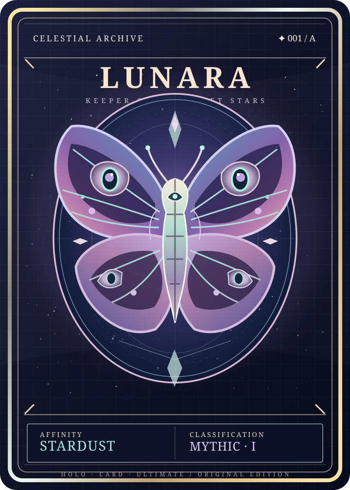

# Holo Card Ultimate · 闪卡究极版

A web-based studio for creating holographic, lenticular, and interactive collectible cards.

面向镭射、闪边、光栅立体与复合特效的角色收藏卡可视化制作工具。这里的「闪卡」指带光学特效的收藏卡，不是学习用的翻转问答卡。

> Project status: research and technical planning. No editor or rendering engine has been implemented yet.

## Direction

- High-fidelity, viewing-angle-responsive optical effects.
- Composable holo foil, reflective borders, metallic surfaces, and lenticular imagery.
- Visual masking and zero-code authoring, with editable projects and reproducible exports.
- Reference projects: [pokemon-cards-css](https://github.com/simeydotme/pokemon-cards-css), [pokemon-cards-151](https://github.com/simeydotme/pokemon-cards-151), and [pokebox](https://github.com/selop/pokebox). Reference their techniques; do not assume their code is freely reusable under the same license.

## Agnir Project Instructions

For durable Project continuity, start from root [`AGENTS.md`](AGENTS.md) and follow the canonical [`AGNIR.md`](AGNIR.md). This heading is only a backward-compatible locator.

## Holo Engine Playground · PoC v0.1

第一版原创闪卡材质原型已经进入源码仓库：Three.js（WebGL2）+ 自定义 GLSL，含三张效果预设、四组独立参数、鼠标/触控/键盘视角交互和当前视角 PNG 导出。



**在本地试用：**

```bash
npm install --no-audit --no-fund
npm test
npm run dev
```

详细说明：[docs/POC-README.md](docs/POC-README.md)。GitHub Actions 包含构建及 Pages 发布工作流；Pages 必须按仓库设置启用后再确认线上 URL。此版本不是成品编辑器，也不等于已经完成浏览器视觉验收。
